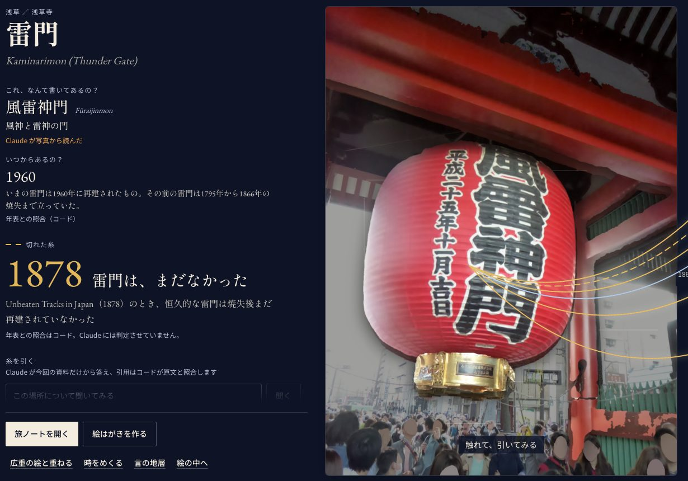
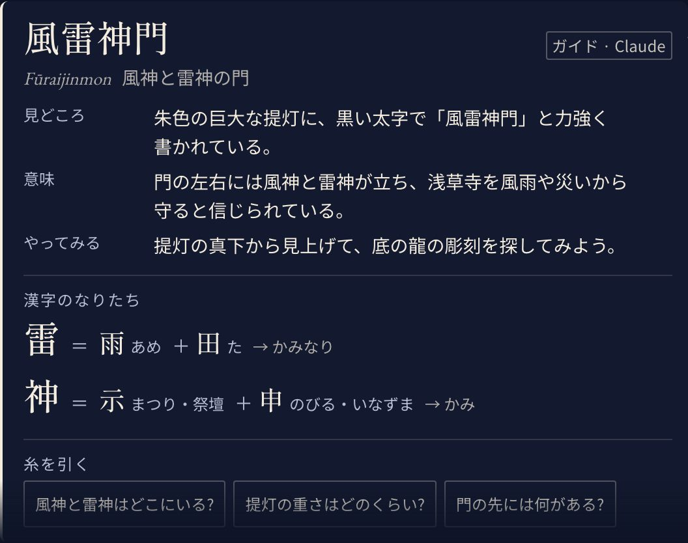
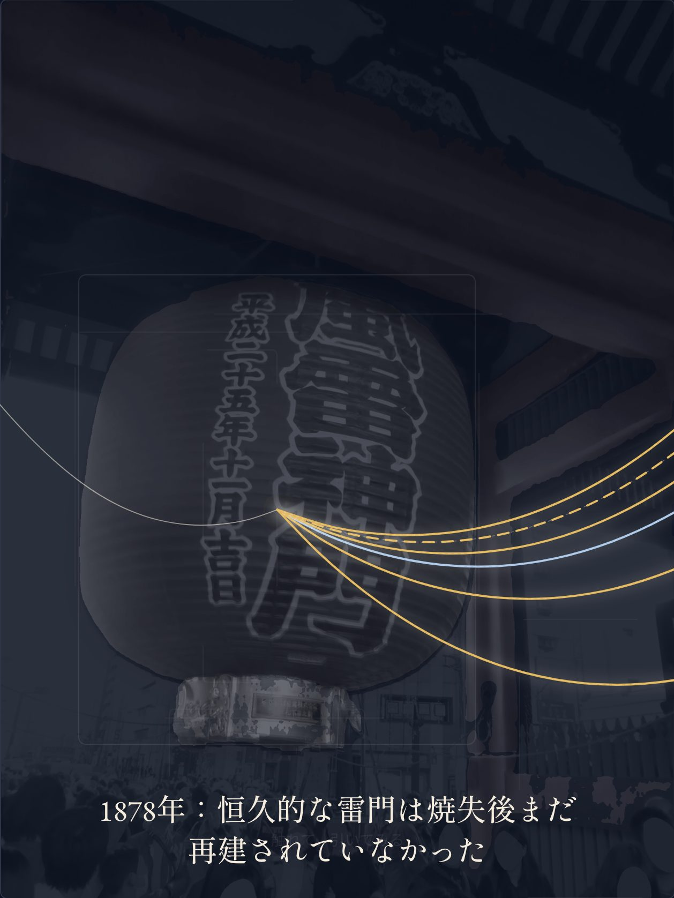
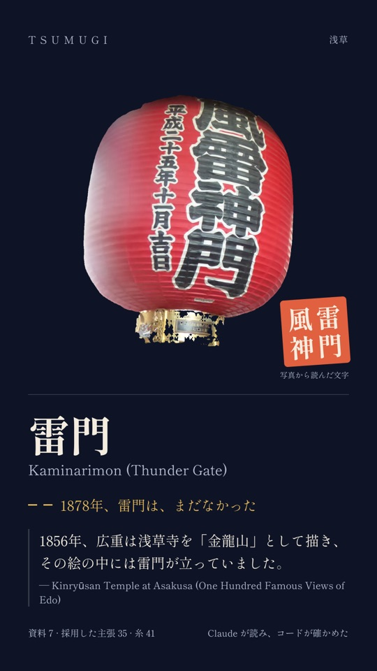
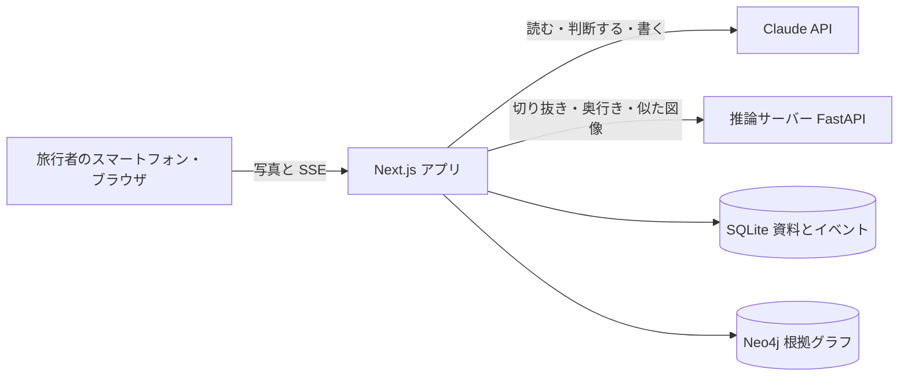

# TSUMUGI（紡ぎ）

[](https://github.com/Shibata-1273352/BuiltwithClaudeJapan2026/actions/workflows/ci.yml) [](LICENSE) [](#claude-code-での開発)

**日本語** | [English](README.en.md)

> 撮るだけで、目の前の日本が、意味と物語になる。

TSUMUGI は、旅先で撮った一枚の写真から、そこに書かれた言葉と、その場所の歴史を、根拠をたどれる形で返すアプリです。Built with Claude Japan 2026 のために、ハッカソン期間中に新規開発しました。



| 読む | 時をめくる | 持ち帰る |
| --- | --- | --- |
|  |  |  |

- **デモ動画：** 提出時に追記（構成は [docs/demo-script.md](docs/demo-script.md)）
- **動かす：** [キーなしで録画を見る](docs/setup.md#キーなしで見る)、[全手順](docs/setup.md)
- **Claude の使い方：** [Claude Code での開発](#claude-code-での開発)
- **評価：** 手作りの小さな評価セットで、資料の刊行年で判定すると存在の判定は 41%、時代の取り違えは 6 件でした。年表で判定すると取り違えは 0 件で、捏造した引用は 4/4 を拒否しました（[詳細と限界](docs/evaluation.md)）

## きっかけ

浅草で、外国人の友人に聞かれました。「これ、なんて書いてあるの？ いつからあるの？」。人と人をつなぐ通信の仕事をしているのに、答えられませんでした。TSUMUGI は、時と場所と人を、確かめた糸でつなぎます。


*生成AIによるコンセプト画像*

## なぜ必要か

- 2025年の訪日客は 42,683,600 人で、過去最多でした（[JNTO、2026-01-21](https://www.jnto.go.jp/news/press/20260121_monthly.html)）。
- 観光庁は 2018 年度から英語解説を延べ約 9,000 本整えてきました。観光地の魅力が「伝わらない」からです（[多言語解説整備支援事業](https://www.mlit.go.jp/tagengo-db/about.html)）。TSUMUGI は、写真からこのデータベースの解説を探し、確かめて引用します。
- 文化庁と観光庁の指針は、直訳ではなく、訪問者の理解に必要なことを補うよう求めています（「文化財の英語解説のあり方について」2016）。

使う人は、日本を好きな旅行者と、案内する日本の友人です。門や看板や提灯の前で、スマートフォンを手にしている場面を想定しています。

## ほかの方法との違い

公開資料で確認できる範囲の比較です（2026-11-04 確認）。

| ほかの方法 | TSUMUGI |
| --- | --- |
| 写真の文字を翻訳する（Google Lens、Papago、DeepL、Apple Visual Look Up） | 筆文字と元号を読み、意味と漢字を説明し、人が確認した年表から「いつからあるか」を答える |
| Web のリンクで答える（Lens の AI Overviews） | 当時の一次資料を日英の原文のまま引用し、主張ごとに引用した文とプログラムで照合する |
| 決まった場所で過去を AR で見せる（Hyper Edohaku XR、NHK AR タイムワープ） | 選んだ年にそれがあったかをプログラムが判定し、資料が食い違えば両方を示す |
| 機関が書いたガイド（Bloomberg Connects、Smartify） | どの写真からでも動き、確かめられる場所でだけ歴史を語り、資料にないことは「書かれていない」と答える |

## 何ができるか

| 体験 | 内容 |
| --- | --- |
| **読む** | Claude が写真の筆文字を原文のまま読み（風雷神門）、小さな銘板は寄って読み直します |
| **答える** | 「いつからあるの？」には、人が確認した年表からプログラムが答えます |
| **探す** | 日英の資料を手分けして読み、足りないと判断すれば Claude が自分で探し直します |
| **確かめる** | 主張は引用した文と照合し、否定の文は事実として採りません |
| **時をめくる** | 年を動かすと、門が焼け、再建されます。その年に門があったかはプログラムが判定します |
| **結ぶ** | 銘板の読みと日英の記録をプログラムが照合し、同じ文字に線を引きます |
| **絵の中へ** | 広重の版画が奥行きを持って開き、雪が舞います |
| **持ち帰る** | 確かめた一文を、絵はがきと旅ノートに残せます |

資料と年表があるのは、雷門（浅草寺）、根本中堂（上野・寛永寺）、吾妻橋の3か所です。雷門と根本中堂の年表は人が確認済みで、吾妻橋はこれから確認します。ほかの場所でも読み取りとガイドは動き、歴史は確かめられる場所でだけ語ります。

## 設計の核：Claude が読み、プログラムが決める

Claude には読むこと、判断すること、書くことを任せます。旅行者が頼りにする「はい／いいえ」は、すべてプログラムが決めます。

| | Claude | プログラム |
| --- | --- | --- |
| 写真 | 文字を読む、場所の候補を挙げる | 場所を辞書と照合する |
| 資料 | 主張を抜き出す、足りないものを判断する | 引用が原文にあるか、否定文でないかを検査する |
| 時間 | 担当しない | 年表と照合し、あった・なかったを判定する |
| 物語 | 主張を引用して書く | 一文ずつ引用を検査し、通らない文は出さない |

アプリの画面でも、Claude の出力とプログラムの判定は別の印で区別しています。処理の流れは[アーキテクチャ](docs/architecture.md)、Claude の使い方は[利用モデル](docs/models.md)と [docs/claude-code.md](docs/claude-code.md) にまとめました。

## 構成図



## 利用モデル

| 役割 | モデル |
| --- | --- |
| 写真を読む、主張の抽出、物語 | Claude Opus 5.5（`claude-opus-5-5`） |
| 不足の判断、視点の見立て、ガイド、質問への回答 | Claude Sonnet 5.5（`claude-sonnet-5-5`）。fast mode では Opus 5.5 |
| 切り抜き | SAM 3 |
| 奥行き | Depth Anything V2 Small |
| 似た図像の検索 | SigLIP so400m |
| 顔のぼかし（端末内） | MediaPipe Face Detector |

バージョンの固定、各段階の詳細、プロンプトの場所は [docs/models.md](docs/models.md) にあります。

## Claude Code での開発

TSUMUGI は Claude Code で開発しました。開発の決まりと道具も、そのままリポジトリに残しています。

| ファイル | 役割 |
| --- | --- |
| [CLAUDE.md](CLAUDE.md) | Claude Code が毎回読む開発の決まり。費用の報告、手で数字を書かないこと、デザインの 10 の規則 |
| [.claude/agents/design-critic.md](.claude/agents/design-critic.md) | 実際の画面を、審査基準とデザインの規則で批評する別の目 |
| [.claude/skills/tsumugi-verify](.claude/skills/tsumugi-verify/SKILL.md) | 変更の種類ごとに、走らせる検証と Claude の費用を示す手順 |
| [.claude/settings.json](.claude/settings.json) | 画面のファイルを編集するたびにデザインの検査を走らせ、失敗を Claude に返すフック |
| [apps/web/src/design.test.ts](apps/web/src/design.test.ts) | デザインの規則をテストにしたもの |
| [video/](video/) | デモ動画のソースコード。編集、Blender の絹糸、作曲もコードです |

計画、批評、検証の進め方と、批評で何が変わったかは [docs/claude-code.md](docs/claude-code.md)（英語）にまとめました。

## 環境構築

必要なもの：Apple Silicon の macOS（メモリ 16GB 以上）、Node.js 22 以上、[uv](https://docs.astral.sh/uv/)、Docker Desktop、gitleaks、Anthropic API キー、Hugging Face アカウント（SAM 3 の利用申請）。

```bash
cp .env.example .env     # 値の入れ方は docs/setup.md を参照
npm ci
npx lefthook install
npm run graph:up && npm run graph:init
```

資料の取り込みとモデルの取得を含む全手順は [docs/setup.md](docs/setup.md) を参照してください。

## ドキュメント

| 文書 | 内容 |
| --- | --- |
| [docs/architecture.md](docs/architecture.md) | 全体構成、処理の流れ、データ、ディレクトリ |
| [docs/models.md](docs/models.md) | 利用モデル、段階ごとの使い分け、API 機能 |
| [docs/setup.md](docs/setup.md) | 環境構築、環境変数、確認コマンド |
| [docs/licenses.md](docs/licenses.md) | 本体、依存、モデル、資料、動画素材のライセンス |
| [docs/evaluation.md](docs/evaluation.md) | 評価、性能、セキュリティの結果 |
| [docs/claude-code.md](docs/claude-code.md) | Claude Code の活用（英語） |
| [docs/REQUIREMENTS.md](docs/REQUIREMENTS.md) | 要件定義 |
| [docs/verification/](docs/verification/) | 検証の記録、年表の人の確認 |
| [video/ASSETS.md](video/ASSETS.md) | デモ動画の素材の出所 |
| [README.en.md](README.en.md) | 英語版。機能の詳細もここにあります |

## 今後の展開（Future Work）

- **場所の選び直し：** Claude の候補から利用者が場所を選べるようにする（FR-07）
- **時間で絞る検索：** 時代の範囲を指定して資料を探す（FR-55）
- **実機での磨き込み：** スマートフォンでの触感、音、フレームレートを計測する
- **多言語化：** 日英に続き、フランス語へ広げる（FR-41）
- **名所の拡大：** 吾妻橋の年表の人の確認と、橋の世代ごとの管理を進め、名所を増やす
- **評価の強化：** 正解データを人が確認し、より難しい事例を加える
- **寄って読むの検証：** 銘板の前半は写真の中でぼやけており、読み取りと知識による補完の切り分けが次の課題です。高解像度の写真で検証する

## ライセンス

本体は [MIT License](LICENSE) です。第三者のソフトウェア、モデル、資料、素材はそれぞれの条件に従います。詳細は [docs/licenses.md](docs/licenses.md) を参照してください。
