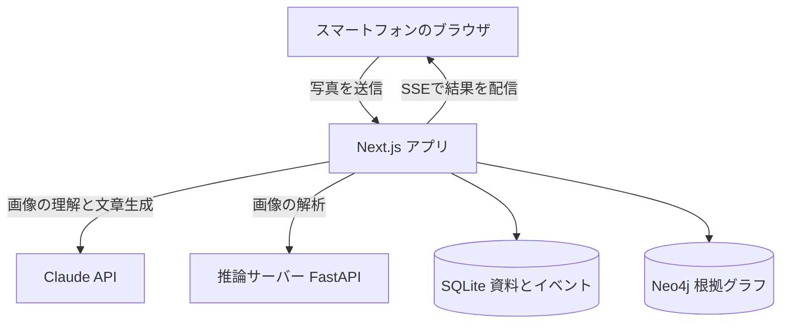

# TSUMUGI（紡ぎ）

[](https://github.com/Shibata-1273352/BuiltwithClaudeJapan2026/actions/workflows/ci.yml) [](LICENSE) [](#claude-codeでの開発)

**日本語** | [English](README.en.md)

> 撮るだけで、目の前の日本が、意味と物語になる。

**▶ [デモ動画を見る（2分51秒、YouTube）](https://youtu.be/ftTCR_WoUME)**

TSUMUGIは、旅先の写真に写る文字を読み、その場所の歴史を原文と出典つきで紹介するWebアプリです。年表を動かして過去の風景をたどり、知ったことを絵はがきや旅ノートに残せます。Built with Claude: Japan 2026のために、ハッカソン期間中に新規開発しました。


| 読む | 時をめくる | 持ち帰る |
| --- | --- | --- |
|  |  |  |

- **試す：** [APIキーなしで操作デモを試す](#apiキーなしで操作デモを試す)、[写真を解析する環境を構築する](#写真を解析する環境を構築する)
- **仕組みを知る：** [Claudeとプログラムの役割分担](#claudeとプログラムの役割分担)
- **開発過程を知る：** [Claude Codeでの開発](#claude-codeでの開発)
- **検証結果を読む：** [評価と限界](#評価と限界)
- **動画の構成を読む：** [デモ動画の台本](docs/demo-script.md)

## きっかけ

浅草で外国人の友人に「これ、なんて書いてあるの？ いつからあるの？」と聞かれ、答えられませんでした。

普段は通信の仕事を通じて、人と人をつないでいます。TSUMUGIでは、目の前の場所について知り、語り合うきっかけをつくりたいと考えました。写真に写る言葉を読み、その場所に残る記録をたどり、異なる時代の風景を重ねます。


*生成AIによるコンセプト画像*

## 誰の、どんな課題を解くか

対象は、日本を訪れる旅行者と、その人たちを案内する日本人です。門や看板、提灯を前に、スマートフォンで調べる場面を想定しています。

写真の文字が読めても、「何を意味するのか」「いつからここにあるのか」まで分かるとは限りません。歴史の説明を読むときも、どの資料に基づくのか、その資料がどの時代の何を指しているのかを確かめる必要があります。

- 2025年の訪日客は42,683,600人で、過去最多でした（[JNTO、2026-01-21](https://www.jnto.go.jp/news/press/20260121_monthly.html)）。
- 観光庁は、観光地の魅力が伝わらないという課題に対し、2018年度から英語解説を延べ約9,000本整備してきました（[多言語解説整備支援事業](https://www.mlit.go.jp/tagengo-db/about.html)）。TSUMUGIは、写真からこのデータベースの解説を探し、引用元と照合して示します。
- 文化庁と観光庁の指針は、直訳ではなく、訪問者の理解に必要なことを補うよう求めています（「文化財の英語解説のあり方について」2016）。

TSUMUGIは、文字の読み取りから資料の探索、年表との照合までを一つの体験につなげます。原文と出典をたどり、資料の記述が一致しない場合は、その違いも確認できます。

### ほかの方法との違い

公開資料で確認できる範囲の比較です（2026-11-04確認）。

| ほかの方法 | TSUMUGI |
| --- | --- |
| 写真の文字を翻訳する（Google Lens、Papago、DeepL、Apple Visual Look Up） | 筆文字と元号を読み、意味と漢字を説明したうえで、年表から「いつからあるか」を答えます |
| Webのリンクで答える（LensのAI Overviews） | 当時の一次資料を日英の原文のまま引用し、記述ごとに引用元の文とプログラムで照合します |
| 決まった場所で過去をARで見せる（Hyper Edohaku XR、NHK ARタイムワープ） | 選んだ年に存在したかをプログラムが判定し、資料が食い違えば両方の根拠を示します |
| 機関が書いたガイド（Bloomberg Connects、Smartify） | どの写真からでも動き、資料で確かめられる場所でだけ歴史を語ります。資料にないことは「書かれていない」と答えます |

## 写真から広がる体験

文字を読むこと、資料を探すこと、過去の風景を見ることを、同じ写真から続けて試せるようにしました。知ったことは、絵はがきや旅ノートに残せます。

| 体験 | 内容 |
| --- | --- |
| **読む** | Claudeが写真の文字を読みます。雷門の例では「風雷神門」を読み取り、小さな銘板は画像を切り抜いて読み直します |
| **答える** | 建物がいつ存在していたかを、登録済みの年表に基づいて判定します |
| **探す** | Claudeが日本語と英語の資料を読み、根拠が足りないと判断した場合は追加の検索語を提案します。プログラムが再検索を実行します |
| **確かめる** | 引用元の文、対象名、否定表現、時代の整合性を、プログラムで検査します |
| **時をめくる** | 年表を動かすと、焼失や再建に応じて門の表示が変わります。選んだ時点の存在を、年表に基づいて判定します |
| **結ぶ** | 写真から読み取った文字と資料内の表記を照合し、一致する箇所を示します。表記の一致だけで同一人物とは断定しません |
| **絵の中へ** | 広重の版画が奥行きを持って開き、雪が舞います |
| **持ち帰る** | 説明の一文を絵はがきにしたり、探索の結果を旅ノートに残したりできます |

### 対応範囲

資料と年表を用意しているのは、雷門（浅草寺）、根本中堂（上野・寛永寺）、吾妻橋です。雷門と根本中堂の年表は人による確認を終えており、吾妻橋は確認が未完了です。

未登録の場所にも文字の読み取りやガイドを返す設計ですが、その場所の歴史を根拠付きで説明できるとは限りません。年表に情報がない場合や、日付を確定できない場合は「不明」として扱います。小さな銘板については、画像からの読み取りとモデルの知識による補完を切り分ける検証が残っています。

## Claudeとプログラムの役割分担

**Claudeが読み、プログラムが決める。** 旅行者が頼りにする「はい／いいえ」は、すべてプログラムが決めます。

Claudeは写真や資料を読み、説明に使う情報を抽出し、追加で調べる内容や物語の文章を考えます。プログラムは、引用元や対象名を照合し、登録済みの年表に基づいて建物の存在を判定します。

この検査は、説明の正しさ全体を保証するものではありません。引用が原文に含まれることと、その引用が説明を意味の上でも裏づけることは、別の検証課題です。

| 処理 | Claudeの役割 | プログラムの役割 |
| --- | --- | --- |
| 写真の理解 | 文字を読み、場所の候補を挙げる | 候補を場所の辞書と照合する |
| 資料の探索 | 記述を抽出し、追加で必要な根拠を判断する | 引用元の文、対象名、否定表現、時代の整合性を検査する |
| 建物の存在判定 | 判定を担当しない | 年表と照合し、存在・不在・不明を判定する |
| 物語の生成 | 採用された情報に参照を付けて文章を書く | 文ごとに参照情報を検査し、検査を通らない文は表示しない |

画面上でも、Claudeが生成した情報とプログラムの判定を区別して表示します。処理の流れは[アーキテクチャ](docs/architecture.md)、モデルとAPIの使い分けは[利用モデル](docs/models.md)、開発での活用は[Claude Codeの活用記録](docs/claude-code.md)にまとめています。

## 評価と限界

引用の原文一致、対象の特定、時代の整合性を、小規模な評価セットで検証しました。評価結果は[評価・性能・セキュリティ](docs/evaluation.md)に記録しています。

- 資料の刊行年を使う比較条件では、存在判定の正解率は41%で、時代の取り違えが6件ありました。年表を使う条件では、取り違えは0件でした。
- 捏造した引用を与える試験では、4件中4件を拒否しました。

評価対象は登録済みの3か所に限られ、正解データはClaude Codeが作成したものです。正解データの人による確認は未完了です。また、存在判定は正解と同じ年表を使用しているため、年表どおりに動くことを確かめる回帰確認として扱っています。未知の場所への対応や、説明全般の正確さを示す結果ではありません。採用方式での、記述が根拠に支持されるかを測る代理指標は67%であり、意味的な裏づけの検証は改善が必要です。

## 構成図



## 利用モデル

| 役割 | モデル |
| --- | --- |
| 画像の読み取り、資料からの情報抽出、物語の生成 | Claude Opus 5.5（`claude-opus-5-5`） |
| 不足する根拠の判断、撮影位置・向きの推定、ガイド、質問への回答 | Claude Sonnet 5.5（`claude-sonnet-5-5`）。fast modeではOpus 5.5 |
| 画像内の対象の切り抜き | SAM 3 |
| 奥行きの推定 | Depth Anything V2 Small |
| 類似画像の検索 | SigLIP so400m |
| 顔のぼかし（端末内） | MediaPipe Face Detector |

モデルの固定バージョン、処理ごとの使い分け、プロンプトの保存先は[利用モデル](docs/models.md)を参照してください。

## 技術スタック

| 層 | 技術 |
| --- | --- |
| Web | Next.js 16（App Router）、React 19、TypeScript、Tailwind CSS 4、Three.js |
| AI | Claude API（Anthropic SDK）、推論サーバーはFastAPIとPyTorch（Apple SiliconのMPS） |
| データ | SQLite（資料とイベント）、Neo4j Community（根拠グラフ） |
| 検証 | Vitest、Playwright、GitHub Actions、gitleaks |
| デモ動画 | Remotion、Blender（Cycles）、Pythonによる作曲 |

## Claude Codeでの開発

Claude Codeを使って、アプリの設計・実装・検証とデモ動画の制作を進めました。開発ルール、レビュー用エージェント、検証手順をリポジトリに保存しています。

| ファイル | 役割 |
| --- | --- |
| [CLAUDE.md](CLAUDE.md) | 開発ルール。API費用の報告、保存済みの計測結果に基づく数値の記載、デザイン規則を定める |
| [.claude/agents/design-critic.md](.claude/agents/design-critic.md) | 実際の画面を確認し、定めた評価観点とデザイン規則に沿って改善点を指摘するレビュー用エージェント |
| [.claude/skills/tsumugi-verify](.claude/skills/tsumugi-verify/SKILL.md) | 変更内容に応じた検証コマンドと、Claude APIの費用を確認する手順 |
| [.claude/settings.json](.claude/settings.json) | 画面の実装ファイルを編集するとデザイン検査を実行し、失敗した場合にClaude Codeへ結果を返すフック |
| [apps/web/src/design.test.ts](apps/web/src/design.test.ts) | デザイン規則を自動で検査するテスト |
| [video/](video/) | 動画編集、Blenderによる糸のCG描画、楽曲の生成を行うコード |

計画からレビュー、検証までの進め方と、レビューを受けて変更した内容は[Claude Codeの活用記録](docs/claude-code.md)（英語）を参照してください。

## 動かし方

### APIキーなしで操作デモを試す

このデモは、実際の探索で保存したイベントと解析結果から画面を再生します。動画ファイルの視聴とは異なり、再生後も年表や版画を操作できます。新しい写真の解析と質問への回答生成は行いません。

Node.js 22以上を使用します。デモの実行にAnthropic APIキー、GPU、Neo4j、推論サーバーは必要ありません。初回の準備では、依存パッケージとデモ用データをダウンロードします。

写真を新しく解析する場合は、Claude APIとローカルの推論サーバーを使用します。このデモでは、保存済みのClaude出力、切り抜き画像、奥行きデータを読み込みます。資料のデータベースと画像は、GitHub Releasesの[`demo-assets-v1`](https://github.com/Shibata-1273352/BuiltwithClaudeJapan2026/releases/tag/demo-assets-v1)で配布しています。

以下のコマンドは、リポジトリを新しくcloneしたディレクトリで実行してください。既存の`.env`がある場合は上書きされるため、実行前に内容を確認してください。

```bash
npm ci
mkdir -p "$HOME/tsumugi-data/cache"
cat > .env <<EOF
DATA_DIR=$HOME/tsumugi-data
ACCESS_TOKEN=$(openssl rand -hex 32)
LOCAL_NO_AUTH=1
DEMO_REPLAY_ID=exp_2c03558d5c6d47cc9072
TSUMUGI_KILL=1
EOF
R=https://github.com/Shibata-1273352/BuiltwithClaudeJapan2026/releases/download/demo-assets-v1
npm run setup:samples                                                     # CC0 のサンプル写真
curl -fsSL "$R/tsumugi-demo-corpus.tar.gz" | tar xz -C "$HOME/tsumugi-data"       # 資料のデータベース
npm run demo:seed                                                         # 録画を読み込む
curl -fsSL "$R/tsumugi-demo-cache.tar.gz" | tar xz -C "$HOME/tsumugi-data/cache"  # 切り抜き、奥行き、広重の版画
npm run build
npm run start -w web -- -H 127.0.0.1                                      # このマシンからだけ開ける
```

[ローカルの再生ページ](http://localhost:3000/replay/exp_2c03558d5c6d47cc9072)を開くと、保存された実行時のタイミングに沿って、文字の読み取りから物語の生成までが再生されます。再生後は、写真の下のボタンから次の操作を試してください。

- **時をめくる → 時を流す：** 年の変化に合わせて、門の焼失と再建をたどれます。焼失日の記録が資料間で一致しない箇所では、両方の根拠を表示します
- **言の地層 → 名をたどる：** 版画に重ねて表示された、各資料の呼び名をたどれます
- **絵の中へ：** 1856年の広重の版画が、奥行きを持って開きます

写真の提灯を選ぶと、文字の読みや説明を確認できます。右の年表で1878年を選ぶと、恒久的な雷門が焼失後まだ再建されていなかったことを確認できます。ここでは、仮設の門と区別して存在を判定しています。

「糸を引く」の質問欄は、このデモでは回答を生成しません。`TSUMUGI_KILL=1`により、新しい探索とClaude APIの呼び出しを停止しています。

審査員向けに、同じ再生方式の[ブラウザデモ](https://tsumugi-demo.onrender.com)を用意しています。アクセスには提出フォームに記載した認証用トークンが必要です。

### 写真を解析する環境を構築する

必要なもの：Apple Silicon搭載のMac（macOS、メモリ16GB以上）、Node.js 22以上、[uv](https://docs.astral.sh/uv/)、Docker Desktop、gitleaks、Anthropic APIキー、Hugging Faceアカウント（SAM 3の利用申請が必要）。

以下は手順の概要です。推論サーバーの準備、資料の取り込み、絵はがき用フォントの配置を含む全手順は、[環境構築ガイド](docs/setup.md)に従ってください。

```bash
cp .env.example .env     # 値の入れ方は docs/setup.md を参照
npm ci
npx lefthook install
npm run graph:up && npm run graph:init
# 推論サーバー、資料とサンプルの準備は docs/setup.md の 3〜4
npm run setup:web-assets
npm run build
npm run start -w web -- -p 3000
```

`ACCESS_TOKEN`を設定した値に置き換え、`http://localhost:3000/?token=<ACCESS_TOKEN>`をブラウザで開いてください。「雷門で試す」を選ぶと、Claude APIを使用した探索が始まります。APIの利用料金が発生します。環境構築の詳細、確認コマンド、費用の目安は[環境構築ガイド](docs/setup.md)を参照してください。

## ドキュメント

| 文書 | 内容 |
| --- | --- |
| [docs/architecture.md](docs/architecture.md) | 全体構成、処理の流れ、データ、ディレクトリ |
| [docs/models.md](docs/models.md) | 利用モデル、段階ごとの使い分け、API機能 |
| [docs/setup.md](docs/setup.md) | 環境構築、環境変数、確認コマンド |
| [docs/licenses.md](docs/licenses.md) | 本体、依存、モデル、資料、動画素材のライセンス |
| [docs/evaluation.md](docs/evaluation.md) | 評価、性能、セキュリティの結果 |
| [docs/claude-code.md](docs/claude-code.md) | Claude Codeの活用（英語） |
| [docs/REQUIREMENTS.md](docs/REQUIREMENTS.md) | 要件定義 |
| [docs/verification/](docs/verification/) | 動作検証と、年表の人による確認の記録 |
| [video/ASSETS.md](video/ASSETS.md) | デモ動画の素材の出所 |
| [README.en.md](README.en.md) | 英語版。機能の詳細もここにあります |

## 今後の課題と展開

- **保存した根拠の再利用：** 現在は、検査した記述と根拠をグラフに保存しています。今後は、同じ場所を再び撮影した際に保存済みの根拠を再利用し、不足する情報をClaudeで追加調査する構成を目指します。検査を通った情報の正しさを、引き続き検証する必要があります
- **場所の選び直し：** Claudeの候補から利用者が場所を選べるようにする（FR-07）
- **時間で絞る検索：** 時代の範囲を指定して資料を探す（FR-55）
- **スマートフォンでの操作性の検証：** 操作への反応、音の再生、描画フレームレートを実機で確認する
- **多言語化：** 日英に続き、フランス語へ広げる（FR-41）
- **対応する場所の拡大：** 吾妻橋の年表を人が確認し、架け替え前後の橋を区別して管理する。資料と年表を整備したうえで、対応する場所を増やす
- **評価の強化：** 正解データを人が確認し、より難しい事例を加える
- **小さな文字の読み取りの検証：** 銘板の一部は写真上で不鮮明なため、高解像度の写真を使い、画像から読めた内容とモデルの知識による補完を切り分ける

## 提出対象のバージョン

Built with Claude: Japan 2026の提出版です。審査対象のソースコードは、タグ`submission`で参照できます。開発の過程は[Issues](https://github.com/Shibata-1273352/BuiltwithClaudeJapan2026/issues?q=is%3Aissue)に残しています。

## 作者と謝辞

作者：柴田 高志（通信事業者のAIエンジニア）

資料と画像は、国立国会図書館、青空文庫、Project Gutenberg、浅草寺、寛永寺、観光庁、The Metropolitan Museum of Art、Wikimedia Commonsの公開資料を使わせていただきました。動画の音源はVSCO 2 Community Editionです。出所と条件は[docs/licenses.md](docs/licenses.md)と[video/ASSETS.md](video/ASSETS.md)にあります。

## ライセンス

アプリ本体のソースコードは[MIT License](LICENSE)で公開しています。第三者のソフトウェア、モデル、資料、素材はそれぞれの条件に従います。詳細は[docs/licenses.md](docs/licenses.md)を参照してください。
