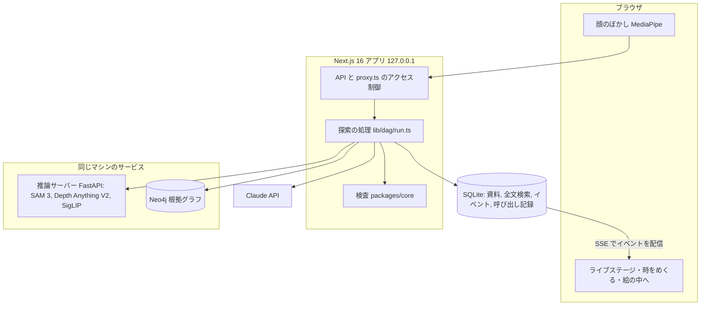
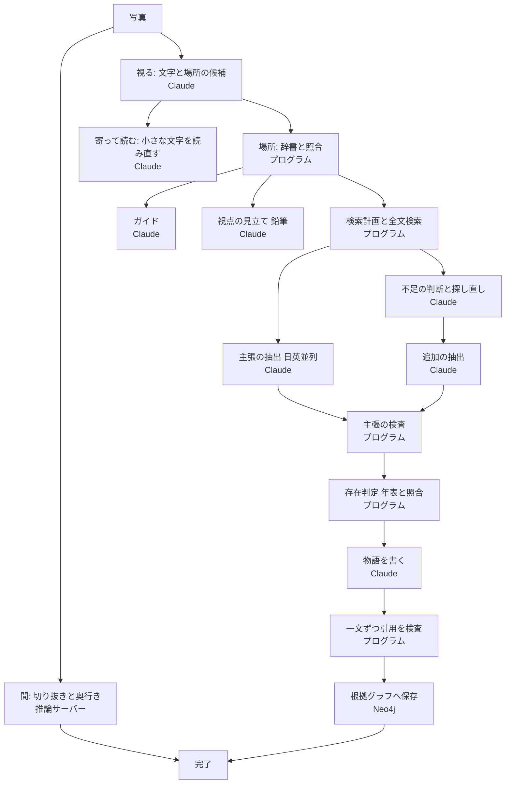

# アーキテクチャ

## 全体構成



| 部品 | 技術 | 役割 |
| --- | --- | --- |
| `apps/web` | Next.js 16、React 19、three.js、Tailwind CSS | 画面、API、Claude の呼び出し、処理の実行 |
| `packages/core` | TypeScript、zod | 共通のスキーマと、主張、時間、存在の判定 |
| `services/inference` | Python 3.12、FastAPI、PyTorch（MPS） | 切り抜き、奥行き、似た図像の検索 |
| `infra/neo4j` | Neo4j Community（Docker） | 根拠グラフ |
| SQLite | better-sqlite3、FTS5 | 資料の全文検索、探索のイベント、Claude の呼び出し記録 |

写真、マスク、奥行き画像、資料の本文は、リポジトリの外の `DATA_DIR` に置きます。

## 探索の流れ

写真を受け取ると、次の処理が並列に進みます。各段階はイベントとして保存され、画面へ配信されます。ライブ、録画の再生、発表モードは同じイベントから同じ画面を作ります（`lib/live/state.ts`）。



辞書にない場所でも読み取りとガイドを返します。歴史は、確かめられる場所でだけ語ります。

## 信頼の境界

| 判断 | 誰が決めるか | 実装 |
| --- | --- | --- |
| 引用が原文にあるか | プログラム。Claude は文番号を指すだけで、引用はプログラムが原文から切り出す | `packages/core/src/claims.ts` |
| 否定の文か | プログラム | 同上 |
| 記録に「見た」とあるか | プログラム。記録にない `observed` は `mentions` に下げる | 同上、`lib/timeline-server.ts` |
| その年に存在したか | プログラム。人が確認した年表と照合する | `packages/core/src/time.ts` |
| 資料が食い違うとき | 解決しない。両方の根拠を示す | `corpus/timeline.json` の `conflicts` |
| 物語の文を出すか | プログラム。引用の検査に通らない文は出さない | `lib/narrate.ts` |
| 銘板と記録の一致 | プログラム。同じ文字だと示すだけで、同一人物とは断定しない | `lib/name-match.ts` |

鉛筆の項目（視点の見立て、連想、似た図像）は解釈であり、主張にも糸にもグラフのノードにもなりません。

## 主なデータ

| 場所 | 内容 |
| --- | --- |
| `corpus/sources.json` | 資料の出所、ライセンス、抜粋 |
| `corpus/entities.json` | 場所と名前の辞書 |
| `corpus/timeline.json` | 存在の出来事、資料の時期、資料間の相違、人の確認の記録 |
| SQLite `events` | 探索のイベント（録画の再生はここから行う） |
| SQLite `ai_calls` | Claude の呼び出しごとの時間と費用 |
| Neo4j | 資料、根拠、主張、時間、場所のグラフ |

## ディレクトリ

```
apps/web/            Next.js アプリ（画面、API、Claude の呼び出し）
packages/core/       共通スキーマと判定ロジック
services/inference/  推論サーバー
infra/neo4j/         Neo4j の docker compose と初期データ
corpus/              資料の定義、辞書、年表
evaluation/          評価セットと結果
scripts/             取り込み、検証、計測、撮影のスクリプト
fixtures/            外部 API の記録（契約テスト用）
tests/               セキュリティテスト
video/               デモ動画の制作コード（Remotion、Blender、作曲）
docs/                文書
```

## 動画の制作

`video/` はアプリとは別のパッケージです。Remotion で編集し、Blender Cycles で糸の映像を描画し、Python で作曲します。画像、音声、動画は Git に含めません。素材の出所は [video/ASSETS.md](../video/ASSETS.md) にあります。
